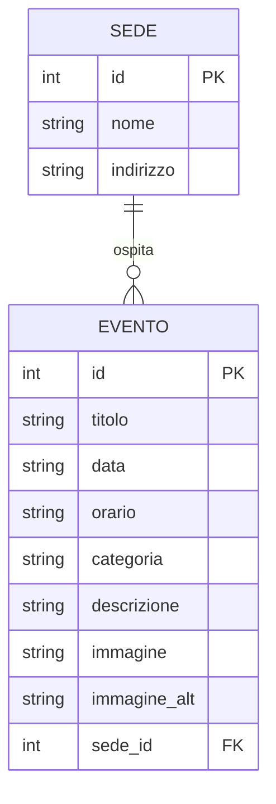

# Scheda dati — Segnale, festival di design

Festival immaginario a Torino, 12–13 giugno 2026, realizzato per un'esercitazione universitaria. I dati stanno in due file JSON nella cartella `dati/`: `eventi.json` e `sedi.json`.

## 1. Entità

- **Evento**: un appuntamento del programma (incontro, laboratorio o mostra). Definito in `eventi.json`.
- **Sede**: un luogo che ospita gli eventi. Definita in `sedi.json`.

## 2. Campi

### Evento (`eventi.json`)

| Campo | Tipo | Esempio |
|---|---|---|
| `id` | numero intero | `1` |
| `titolo` | testo | `"Lettere in movimento"` |
| `data` | testo, formato `AAAA-MM-GG` | `"2026-06-12"` |
| `orario` | testo, formato `HH:MM` | `"10:00"` |
| `categoria` | testo (`Incontro`, `Laboratorio` o `Mostra`) | `"Incontro"` |
| `descrizione` | testo | `"Come cambia un messaggio quando cambiano le lettere? Un incontro su tipografia, ritmo e comunicazione visiva."` |
| `immagine` | testo, percorso relativo alla radice del sito | `"assets/lettere-in-movimento.svg"` |
| `immagine_alt` | testo, descrizione dell'immagine | `"Lettere geometriche disposte su una griglia"` |
| `sede_id` | numero intero, riferimento a `Sede.id` | `1` |

### Sede (`sedi.json`)

| Campo | Tipo | Esempio |
|---|---|---|
| `id` | numero intero | `1` |
| `nome` | testo, nel formato «nome del luogo — nome della sede» | `"Officina Nord — Sede centrale"` |
| `indirizzo` | testo | `"Corso Duca degli Abruzzi 24, Torino"` |

Nome e indirizzo della sede si scrivono **solo** in `sedi.json`: gli eventi non li ripetono, li richiamano con `sede_id`.

## 3. Chiave primaria

Per entrambe le entità la chiave primaria è `id`, un numero intero che:

- è **univoco** all'interno dell'entità (non esistono due eventi, né due sedi, con lo stesso `id`);
- è **stabile**: una volta assegnato non cambia e non viene riutilizzato, anche se il titolo, il nome o l'indirizzo vengono modificati.

Gli `id` non devono essere consecutivi.

## 4. Relazione

Una sede può ospitare più eventi; ogni evento si svolge in una sola sede (relazione uno-a-molti).
`Evento.sede_id` fa riferimento a `Sede.id`.

| `sede_id` | Sede | Eventi |
|---|---|---|
| 1 | Officina Nord — Sede centrale | Lettere in movimento, Oggetti in dialogo |
| 2 | Spazio Forma — Politecnico al Valentino | Materia seconda, Mappe da abitare, Progettare insieme |
| 3 | Cortile Comune — Sede di Mirafiori | La città in un manifesto |

## 5. Quantità

- 6 eventi (`id` 1, 2, 3, 4, 5, 6)
- 3 sedi (`id` 1, 2, 3)

## 6. Chi aggiorna i dati e come

I dati sono aggiornati da chi cura il progetto (l'autore del sito), modificando i file JSON nella repository `festival-segnale` e pubblicando le modifiche con GitHub Pages dal ramo `main`.

1. Si modifica il file in `dati/` (`eventi.json` per gli eventi, `sedi.json` per le sedi) e si controlla che sia JSON valido.
2. Se si aggiunge un evento, si usa un `id` nuovo e un `sede_id` che esiste in `sedi.json`.
3. Se la modifica riguarda gli eventi, la pagina Programma si aggiorna da sola (legge i JSON). La pagina Info e luoghi invece è scritta a mano: le modifiche a sedi ed eventi vanno riportate anche lì (vedi punto 7).
4. Si fa il commit e il push su `main`: GitHub Pages ripubblica il sito.

## 7. Che cosa mostra la pagina

- **Programma** (`programma.html`): carica `eventi.json` e `sedi.json` con `fetch` e costruisce le schede. Per ogni evento mostra immagine, giorno, orario e categoria, titolo, descrizione e nome della sede preso da `sedi.json` tramite `sede_id`. Gli eventi sono ordinati per data e orario. Se un `sede_id` non corrisponde a nessuna sede, l'evento compare comunque con «Sede da definire». Durante il caricamento, quando non ci sono eventi e quando un file non si legge, la pagina mostra un messaggio.
- **Info e luoghi** (`info.html`): per ora è scritta direttamente nell'HTML. Mostra la fotografia di ogni sede, nome e indirizzo con il link alle indicazioni, la mappa e l'elenco degli eventi che la sede ospita, con giorno e orario.

Il `fetch` funziona solo se la pagina è servita da un server (GitHub Pages, oppure l'estensione Live Server in VS Code), non aprendo il file direttamente dal disco.

## Schema Evento–Sede

Lettura: una **Sede** ospita zero o più **Eventi**; ogni **Evento** appartiene a una sola **Sede** (`Evento.sede_id` → `Sede.id`).